# DREAMINA CANVAS / NODES ZERO-CREDIT PRODUCTION PIPELINE
### Optimized for Seedream (Ultra-Realism Images) & Seedance 2.5 (Dynamic Video)
**Channel:** [@PlotTwistStudios-j4t](https://youtube.com/@plottwiststudios-j4t)  
**Series:** *PROJECT: CHRONO-ZERO (Vault 73)*  
**Target:** 20k–100k+ Views | 130%+ Average Percentage Viewed (APV) Infinite Loop

---

## 🔒 Security & Execution Notice
> [!IMPORTANT]
> Because Dreamina uses web-based Cloudflare Turnstile bot verification, CAPTCHAs, and session authentication, automated bots cannot directly log into your Dreamina account via remote terminal without risking account lockouts or security flags.
>
> **You do NOT need to risk your credentials:** Everything has been pre-configured below into a turnkey **Node-by-Node Canvas Blueprint**. You can open Dreamina Canvas, set your unlimited generation toggle, and paste each node card directly to generate your reels with **ZERO credits deducted**.

---

## ⚙️ 1. Zero-Credit Unlimited Mode Setup in Dreamina Canvas

To guarantee you do not consume any of your fast generation credits:

1. **Open Dreamina Canvas / Nodes:** Navigate to `dreamina.capcut.com` -> Click **Canvas / Nodes** (Infinite Node Editor).
2. **Select Generation Mode:** In the bottom-right or top settings bar of the Node Canvas, look for **Generation Speed / Mode**:
   - ❌ Switch OFF **"Turbo" / "Fast Speed"** (this uses fast credits).
   - ✅ Select **"Standard" / "Unlimited"** (under your subscription, this grants unlimited queued generations at zero credit cost).
3. **Aspect Ratio Lock:** Always set the Canvas generation node ratio to **`9:16`** (Vertical Shorts & Reels format: 1080x1920).
4. **Resolution Setting:** Use **Standard HD (1080p)** for generation. (Dreamina Canvas allows unlimited upscaling on completed clips).

---

## 🧠 2. Dreamina Canvas Node Connection Architecture

In Dreamina Canvas, connecting nodes in sequence maintains 100% character facial consistency and seamless vector transitions across all shots:

```mermaid
flowchart LR
    AnchorNode["[Node 0: Master Character Anchor]\nSeedream Image Gen\n(#MERCER_CORE_V1 Lock)"] 
    
    subgraph Shot1_Group ["SHOT 1: The Vault Breach (0:00 - 0:08)"]
        S1_Img["[Node 1A: Keyframe]\nSeedream Ultra-Realism\nEye Macro & Bunker Entrance"]
        S1_Vid["[Node 1B: Video Generation]\nSeedance 2.5 (8s)\nBackward Zoom from Pupil"]
    end

    subgraph Shot2_Group ["SHOT 2: The Discovery (0:08 - 0:16)"]
        S2_Img["[Node 2A: Keyframe]\nSeedream Ultra-Realism\nCryo-Pod & Dead Mercer Face"]
        S2_Vid["[Node 2B: Video Generation]\nSeedance 2.5 (8s)\nContinuous Downward Tilt"]
    end

    subgraph Shot3_Group ["SHOT 3: The Tape Recorder (0:16 - 0:24)"]
        S3_Img["[Node 3A: Keyframe]\nSeedream Ultra-Realism\nFrozen Hand & Blinking Tape"]
        S3_Vid["[Node 3B: Video Generation]\nSeedance 2.5 (8s)\nRotational Push-In to Tape"]
    end

    subgraph Shot4_Group ["SHOT 4: Cliffhanger & Loop Exit (0:24 - 0:30)"]
        S4_Img["[Node 4A: Keyframe]\nSeedream Ultra-Realism\nCorpse Hazel Pupil Alignment"]
        S4_Vid["[Node 4B: Video Generation]\nSeedance 2.5 (6s)\nCrash Zoom to Pupil"]
    end

    AnchorNode -->|Character Reference Input| S1_Img
    AnchorNode -->|Character Reference Input| S2_Img
    AnchorNode -->|Character Reference Input| S4_Img
    
    S1_Img -->|Start Frame| S1_Vid
    S1_Vid -->|Extract Last Frame| S2_Img
    S2_Img -->|Start Frame| S2_Vid
    S2_Vid -->|Extract Last Frame| S3_Img
    S3_Img -->|Start Frame| S3_Vid
    S3_Vid -->|Extract Last Frame| S4_Img
    S4_Img -->|Start Frame| S4_Vid
    
    S4_Vid -.->|Infinite Retention Loop to Frame 1| S1_Vid
```



---

## 📋 3. Master Character Lock Reference Node (Run First)

Before generating individual episode shots, generate this master image once in Dreamina Canvas. You will plug its output image into the **Reference / Face Lock** input port of all subsequent nodes.

### [Node 0: Master Character Anchor]
* **Node Type:** Image Generation (Text-to-Image)
* **Model:** **Seedream** (Ultra-Realism Mode)
* **Aspect Ratio:** `9:16`
* **Prompt:**
  ```text
  candid cinematic photorealistic portrait of James Mercer (#MERCER_CORE_V1), 34-year-old rugged male detective, piercing ice-hazel eyes, sharp angular jawline with heavy 3-day stubble, distinct 1.2cm diagonal scar cutting right eyebrow, wearing charcoal-black wool tactical trench coat with raised collar over obsidian-black ribbed turtleneck, worn leather shoulder holster, ultra-realistic 8k, hyper-detailed skin pores, volumetric neon-amber and cyan rim lighting, anamorphic lens flare, Arri Alexa 65, 85mm lens, masterwork --ar 9:16
  ```
* **Negative Prompt:**
  ```text
  blurry, low resolution, plastic skin, airbrushed textures, flat lighting, oversaturated cartoon style, morphing hands, extra fingers, deformed facial features, inconsistent eye color, washed-out blacks, low contrast, distorted perspective, 3d render look, anime, illustration
  ```

---

## 🎬 4. Ready-to-Execute Node Cards: Episode 1 — "The Cold Body"

Execute these nodes one by one in Dreamina Canvas:

---

### 🔹 NODE 1A: Keyframe — The Vault Entrance
* **Node Type:** Image Generation (Text-to-Image)
* **Model:** **Seedream**
* **Reference Port:** Connect Output from **Node 0** (Weight: `0.85`)
* **Aspect Ratio:** `9:16`
* **Prompt:**
  ```text
  Cinematic extreme macro eye close-up of James Mercer (#MERCER_CORE_V1), hyper-detailed dilated hazel iris with visible micro-capillaries reflecting a flickering cyan neon sign reading "VAULT 73". Half of face illuminated by high-contrast volumetric frost vapor and radioactive amber emergency strobe, ultra-realistic 8k, sub-surface skin scattering, Arri Alexa 65 anamorphic.
  ```
* **Negative Prompt:** `cartoon, 3d render, illustration, smooth plastic skin, blur, watermark, extra limbs`

---

### 🔹 NODE 1B: Video Clip 1 — The Vault Breach (0:00 - 0:08)
* **Node Type:** Image-to-Video (I2V)
* **Model:** **Seedance 2.5**
* **Input Port:** Connect Output of **Node 1A** into **"Start Frame"**
* **Duration:** 8 Seconds
* **Camera Movement / Motion Prompt:**
  ```text
  [Camera: Dynamic high-speed backward pull out from extreme close-up of hazel eye pupil, pulling back into medium over-the-shoulder tracking shot] James Mercer steps forward into abandoned cryogenic bunker chamber Vault 73. Heavy cold breath vapor billowing from his mouth, dynamic flashlight beam cutting through frosty vapor, glowing floor grates, heavy volumetric atmosphere, cinematic motion blur, 8k photorealistic.
  ```
* **Audio / Dialogue Sync (Native Seedance Audio):**
  - **Dialogue:** *"They told me Vault 73 was sealed forty years ago. But the frost on the lock was fresh."*
  - **SFX Bed:** Heavy metallic hatch creak, sharp hiss of escaping liquid nitrogen, low 30Hz sub-bass braam.

---

### 🔹 NODE 2A: Keyframe — The Frosted Cryo-Pod
* **Node Type:** Image Generation (Text-to-Image / Frame Extract)
* **Model:** **Seedream**
* **Reference Port:** Connect Output from **Node 0** (Weight: `0.90`)
* **Aspect Ratio:** `9:16`
* **Prompt:**
  ```text
  Top-down cinematic close-up through frosted tempered glass of cryogenic chamber. Tactical flashlight beam cutting through ice mist. Beneath the scratched frost-covered glass lies an unmoving male corpse with the exact facial structure, heavy stubble, and right eyebrow scar as James Mercer (#MERCER_CORE_V1), wearing identical charcoal wool trench coat. Saturated electric cyan and sodium-amber dual lighting, water droplets on glass, 8k photorealism.
  ```
* **Negative Prompt:** `cartoon, plastic skin, distorted face, anime, bad anatomy, overexposed`

---

### 🔹 NODE 2B: Video Clip 2 — The Discovery (0:08 - 0:16)
* **Node Type:** Image-to-Video (I2V)
* **Model:** **Seedance 2.5**
* **Input Port:** Connect Output of **Node 2A** into **"Start Frame"**
* **Duration:** 8 Seconds
* **Camera Movement / Motion Prompt:**
  ```text
  [Camera: Continuous vertical downward tilt following intense tactical flashlight beam, settling into top-down glass perspective] Gloved tactical hand wipes frost across tempered glass of cryogenic preservation chamber. Flashlight illuminates the dead Mercer corpse beneath the ice. Dramatic camera drift, rising frost mist, photorealistic reflections on glass.
  ```
* **Audio / Dialogue Sync (Native Seedance Audio):**
  - **Dialogue:** *"Wiped the glass expecting a stranger. What I saw made my blood stop."*
  - **SFX Bed:** Glove squeak on frozen glass, sudden deep sub-bass drop, eerie rising violin screech.

---

### 🔹 NODE 3A: Keyframe — The Blinking Cassette
* **Node Type:** Image Generation (Text-to-Image)
* **Model:** **Seedream**
* **Aspect Ratio:** `9:16`
* **Prompt:**
  ```text
  Cinematic macro shot inside open cryogenic chamber, pale frozen male hand with frost crystals on knuckles, tightly clutching a retro black micro-cassette tape recorder. The red recording LED light is glowing bright crimson with an intense anamorphic lens flare. High-contrast electric cyan shadows, floating ice particles, photorealistic 8k, Panavision anamorphic lens.
  ```
* **Negative Prompt:** `extra fingers, distorted hand, cartoon, smooth textures, blurry, 3d render`

---

### 🔹 NODE 3B: Video Clip 3 — The Audio Tape (0:16 - 0:24)
* **Node Type:** Image-to-Video (I2V)
* **Model:** **Seedance 2.5**
* **Input Port:** Connect Output of **Node 3A** into **"Start Frame"**
* **Duration:** 8 Seconds
* **Camera Movement / Motion Prompt:**
  ```text
  [Camera: Smooth rotational corkscrew push-in diving into cryogenic chamber toward the hand] Close-up of frozen pale hand clutching micro-cassette recorder. The red recording light on the cassette tape pulses rhythmically in bright crimson. Atmospheric frost vapor swirls around fingers, hyper-detailed textures, shallow depth of field.
  ```
* **Audio / Dialogue Sync (Native Seedance Audio):**
  - **Dialogue:** *"He wasn't just dead. He was clutching an analog cassette... and the record light was blinking."*
  - **SFX Bed:** Mechanical click of cassette head engaging, magnetic tape hiss, rapid mechanical clock ticking.

---

### 🔹 NODE 4A: Keyframe — The Cliffhanger Alignment
* **Node Type:** Image Generation (Text-to-Image)
* **Model:** **Seedream**
* **Reference Port:** Connect Output from **Node 0** (Weight: `0.90`)
* **Aspect Ratio:** `9:16`
* **Prompt:**
  ```text
  Extreme close-up macro portrait of frozen dead James Mercer (#MERCER_CORE_V1) inside cryo-pod. Head tilted back, eyes wide open, dilated hazel iris centered perfectly in frame, reflecting flickering neon amber warning beacons. Ice crystals on eyelashes and pale lips, hyper-detailed skin pores, cinematic 8k.
  ```
* **Negative Prompt:** `closed eyes, blurry, plastic skin, cartoon, bad framing, off-center pupil`

---

### 🔹 NODE 4B: Video Clip 4 — The Loop Exit (0:24 - 0:30)
* **Node Type:** Image-to-Video (I2V)
* **Model:** **Seedance 2.5**
* **Input Port:** Connect Output of **Node 4A** into **"Start Frame"**
* **Duration:** 6 Seconds
* **Camera Movement / Motion Prompt:**
  ```text
  [Camera: Ultra-fast crash zoom into cassette recorder speaker then rapid whip-pan up into macro close-up of dead Mercer's dilated hazel eye] Camera accelerates rapidly into dead Mercer's open eye pupil, aligning directly into the center of the dark pupil right at the final second. Strobe amber warning lights casting dramatic pulses, cinematic 60fps motion blur.
  ```
* **Audio / Dialogue Sync (Native Seedance Audio):**
  - **Dialogue (From Tape in Mercer's voice):** *"And the scariest part about finding your own dead body... is realizing that the person who put you in this vault..."*
  - **SFX Bed:** Loud mechanical tape screech followed by an abrupt `SFX_SUCTION_CUT` (pure dead vacuum silence right on the last syllable).

---

## 🔄 5. The Infinite Retention Loop Secret (130%+ APV)

When assembling the 4 video clips in CapCut / Premiere:
1. **Zero Gap / Zero Outro:** Place Clip 1, Clip 2, Clip 3, Clip 4 back-to-back. Do **NOT** add fade-to-black, do **NOT** add subscribe buttons.
2. **Audio Connection:**
   - **Clip 4 Ending Line:** *"And the scariest part about finding your own dead body... is realizing that the person who put you in this vault..."*
   - **Clip 1 Opening Line:** *"...was you. They told me Vault 73 was sealed forty years ago..."*
   - As soon as the reel replays on Shorts / Reels, the sentence finishes itself smoothly into an infinite mind-loop!
3. **Visual Alignment:**
   - Clip 4 ends diving into the dead body's pupil.
   - Clip 1 begins bursting out of living Mercer's eye pupil.
   - The loop looks like an intentional cosmic paradox warp!

---

## ⚡ 6. How to Continue for Episodes 2–20

To produce Episodes 2 through 20 under the exact same zero-credit node workflow:
- Keep **Node 0 (Master Anchor)** fixed in your Dreamina Canvas.
- Open **[EPISODES_1_TO_10.md](file:///home/runner/work/this-is-my-channel-it-s-views/this-is-my-channel-it-s-views/EPISODES_1_TO_10.md)** or **[EPISODES_11_TO_20.md](file:///home/runner/work/this-is-my-channel-it-s-views/this-is-my-channel-it-s-views/EPISODES_11_TO_20.md)**.
- Each episode contains the exact 4-shot breakdown and Seedance prompts.
- Simply plug the Seedream image prompt into Node A, and the Seedance motion prompt into Node B.
- Hit **Generate (Unlimited Mode)** one by one!
